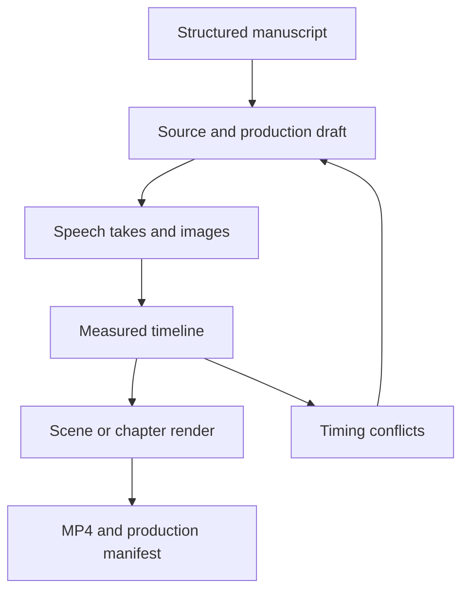

# Story Studio architecture and implementation priorities

Status: first working production slice, 2026-10-21. This document describes implemented behavior; unchecked items are future work.

## Ownership and data flow

The video service owns the local story editor and production data. Shared contracts live in `manganarrator_contracts`. The existing Next.js manga frontend, OCR, Paddle and orchestrator do not need changes to run a story project.

The story hierarchy is series → arc → chapter → scene. A scene owns script segments, independent visual shots and sound beds. Stable IDs connect source references, spoken lines and optional visual anchors. Character records carry voice defaults. Assets are registered separately, so one image can serve many shots and replacing a speech take does not replace the scene.

| Boundary | Implementation | Important invariant |
| --- | --- | --- |
| Contract | Python/Pydantic, TypeScript and generated JSON Schema | Separate from manga/OCR DTOs; unique IDs and validated references |
| Import | `video/app/story/importer.py` | Explicit Markdown grammar or normalized JSON; rejects unrecognized chat/prose |
| Editing | `video/frontend/src/StoryStudio.jsx` | Canonical source stays read only; adaptation profile is an editorial brief |
| Persistence | `video/app/story/store.py` | Atomic current-project replacement; saved revision snapshots; optimistic revision checks |
| Media ingestion | Story asset endpoint | Server decodes audio to PCM, measures with FFprobe and owns filenames/durations |
| Timing | `video/app/story/timeline.py` | Audio duration plus explicit pauses is the master clock |
| Rendering | `video/app/story/render.py` | Reuses FClip, concat helpers, Audio Studio render lock and SQLite jobs |
| Delivery | Existing video API and Studio | Local MP4/manifest downloads; no automatic publication |

Paths above abbreviate the `manganarrator_video` repository as `video`.

## Editing and timing decisions

Canonical text and source references cannot change through the draft-save API. A scene lock protects its content, takes and effective character voices. Undo covers unsaved edits; saved history can be restored as a new revision without deleting later assets. Importing a new manuscript is currently required to change the scene structure.

Each speech take records a fingerprint of text, speaker, effective voice, emotion and direction. A relevant edit keeps the take available but marks it stale and blocks export. Replacing a single take recalculates subsequent audio positions. Automatic shots follow measured scene time or explicit segment anchors. Manual positions retain their scene-relative start and duration; gaps, overlaps and out-of-bounds placements become visible conflicts.

Rendering snapshots the requested project revision. It checks asset hashes/durations, assembles speech and silence, renders still-image shots, mixes sound beds and emits an MP4 plus a manifest. Visual boundaries are rounded to video frames; the audio clock remains authoritative. The manifest captures the project, measured timeline, settings and output hash. It is an audit record, not a portable media backup.

## Operational limits

- Single local user and one API worker; no shared editing or internet-facing authentication.
- FFmpeg/FFprobe on PATH. CPU rendering verified; GPU/model inference is outside this slice.
- The asset store and project revisions must be backed up separately from Git.
- Speech is imported per segment. The existing TTS request requires manga references, so native story TTS needs an additive adapter.
- Automatic adaptation, raw-chat conversion, scene structure editing, cross-dissolves and portable media bundles are not implemented.
- Profile selectors record editing intentions. They do not silently rewrite text or promise an unavailable model operation.

## Prioritized checklist

### First real episode

- [x] Story contracts, source references and strict import.
- [x] Source/draft editor, voice metadata, independent shots and sound beds.
- [x] Per-segment audio import/replacement and measured timing.
- [x] Saved revisions, duplication, scene locks and conflict reporting.
- [x] Scene preview, chapter render, MP4/manifest export.
- [ ] Import the private episode package; record or generate its final speech takes.
- [ ] Select consistent character references and make the planned illustrations.
- [ ] Resolve timing conflicts after final takes; review a complete episode render.
- [ ] Review title, thumbnail, captions, audio levels and rights; publish only with explicit authorization.

### Next automation, after one manual episode

1. **Native story TTS adapter** — reuse the existing engine without fabricated image references; return registered per-segment takes and preserve voice choices. Validate failure/retry/cancellation and stale-take behavior.
2. **Portable project bundle** — ZIP import/export with hashes, relative asset references and traversal protection. Roundtrip a project with revision history.
3. **Structure editing** — add/reorder chapters, scenes and lines while keeping stable source IDs, history and locks.
4. **Adaptation drafts** — generate a separate proposed revision, show the diff and respect locked scenes. Keep canon and user approval separate from model output.
5. **Timeline refinements** — waveforms, drag edits and cross-dissolves only after manual placement pain points are observed.

Launch commands, API details and executed validation belong in the [video service guide](https://github.com/whenigetout/manganarrator_video/blob/main/docs/STORY_STUDIO.md) and its [project context](https://github.com/whenigetout/manganarrator_video/blob/main/docs/PROJECT_CONTEXT.md). Future agents should start with those focused notes instead of auditing every service again.
